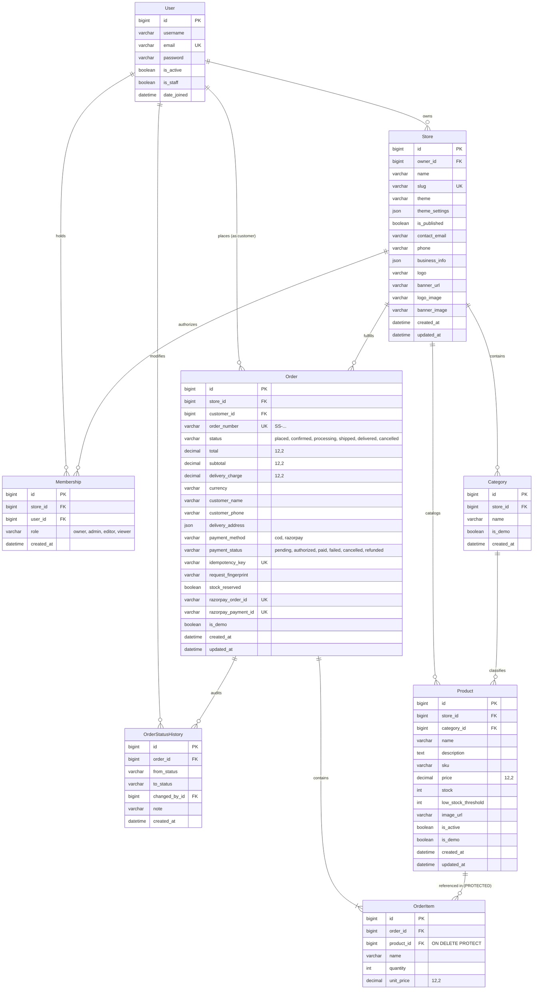

# DATABASE DESIGN & DATA MODEL SPECIFICATION
## Project: Technova — SmartStore AI
**Document Version:** 1.0.0
**Status:** Approved Architectural Baseline
**Date:** 2026-11-09
**Author:** Database Architect & Backend Engineering Team
**Repository:** `V:\Technova-recovery`

---

## 1. DATABASE TECHNOLOGY STRATEGY

### 1.1 Technology Selection: TiDB Cloud (Serverless) vs PostgreSQL
* **Current Engine:** TiDB Cloud Serverless (MySQL 8.0 wire protocol, port 4000).
* **Evaluation & Rationale:**
  * **Scalability:** TiDB is a distributed NewSQL database providing horizontal scale, distributed ACID transactions, and zero-sharding operational elasticity.
  * **Free-Tier Viability:** TiDB Cloud provides 5 GiB of row-based storage and 50 million Request Units (RU) per month permanently free with automated Let's Encrypt TLS encryption (ISRG Root X1 CA).
  * **Compatibility:** Python's pure-Python `PyMySQL` driver connects seamlessly without requiring native C client libraries (`libmysqlclient`), simplifying Docker builds and container portability on Render.
  * **Recommendation:** **Retain TiDB Cloud Serverless** as the primary production database. SQLite is preserved exclusively for in-memory automated unit testing (`:memory:`).

---

## 2. MULTI-TENANCY DATA ARCHITECTURE

Technova implements the **Shared Database, Shared Schema with Discriminator Column (`store_id`)** pattern.

### Why Shared Schema with Discriminator Column?
1. **Infrastructure Efficiency:** Supports thousands of micro-merchants on a single database instance with zero schema migration overhead per tenant.
2. **Resource Optimization:** Operates well within the ₹0 free-tier constraints of TiDB Cloud Serverless.
3. **Operational Simplicity:** A single set of Django database migrations updates all tenant schemas simultaneously.
4. **Data Isolation Enforcement:** Tenant isolation is enforced programmatically at the ORM layer by mandating `store_id` foreign keys, composite unique constraints (`[store_id, sku]`, `[store_id, name]`), and composite query indexes.

---

## 3. ENTITY-RELATIONSHIP (ER) DIAGRAM



---

## 4. DETAILED RELATIONAL SCHEMA SPECIFICATION

### 4.1 `accounts_user` (Identity)
| Column | Type | Constraints | Description |
|---|---|---|---|
| `id` | `BIGINT` | Primary Key, Auto-increment | Internal unique user identifier |
| `email` | `VARCHAR(254)` | Unique, Not Null, Indexed | Primary login credential (`USERNAME_FIELD`) |
| `username` | `VARCHAR(150)` | Not Null | Display handle |
| `password` | `VARCHAR(128)` | Not Null | Hashed password string (PBKDF2/Argon2) |
| `is_active` | `BOOLEAN` | Default True | Account state flag |
| `date_joined`| `DATETIME(6)` | Auto-now-add | Registration timestamp |

### 4.2 `stores_store` (Tenant Definition)
| Column | Type | Constraints | Description |
|---|---|---|---|
| `id` | `BIGINT` | Primary Key, Auto-increment | Unique store ID |
| `owner_id` | `BIGINT` | Foreign Key (`accounts_user.id`), `ON DELETE PROTECT` | Business owner account |
| `name` | `VARCHAR(160)`| Not Null | Merchant business name |
| `slug` | `VARCHAR(80)` | Unique, Not Null, Indexed | URL path identifier (`/store/:slug`) |
| `theme` | `VARCHAR(32)` | Default 'modern-clean' | Active storefront styling preset |
| `theme_settings`| `JSON` | Default `{}` | Custom hex colors, banner layout settings |
| `business_info`| `JSON` | Default `{}` | Business address, legal registration, description |
| `is_published` | `BOOLEAN` | Default False | Public visibility toggle |
| `created_at` | `DATETIME(6)` | Auto-now-add | Store provisioning timestamp |

### 4.3 `stores_membership` (Tenant RBAC)
| Column | Type | Constraints | Description |
|---|---|---|---|
| `id` | `BIGINT` | Primary Key, Auto-increment | Membership ID |
| `store_id` | `BIGINT` | Foreign Key (`stores_store.id`), `ON DELETE CASCADE` | Associated tenant |
| `user_id` | `BIGINT` | Foreign Key (`accounts_user.id`), `ON DELETE CASCADE` | Associated user |
| `role` | `VARCHAR(16)` | Choices: `owner`, `admin`, `editor`, `viewer` | Authorization level |
| *Constraint* | `UNIQUE` | `(store_id, user_id)` | Single role per user per store |

### 4.4 `stores_product` (Tenant Catalog)
| Column | Type | Constraints | Description |
|---|---|---|---|
| `id` | `BIGINT` | Primary Key, Auto-increment | Product ID |
| `store_id` | `BIGINT` | Foreign Key (`stores_store.id`), `ON DELETE CASCADE` | Tenant owner |
| `category_id` | `BIGINT` | Foreign Key (`stores_category.id`), `ON DELETE SET NULL`, Nullable | Category association |
| `name` | `VARCHAR(180)`| Not Null | Product title |
| `sku` | `VARCHAR(80)` | Nullable | Stock Keeping Unit |
| `price` | `DECIMAL(12,2)`| Not Null | Unit selling price (INR) |
| `stock` | `INT UNSIGNED`| Default 0 | Real-time available inventory |
| `low_stock_threshold`| `INT UNSIGNED`| Default 5 | Restock notification threshold |
| `is_active` | `BOOLEAN` | Default True | Product active in catalog |
| *Constraint* | `UNIQUE` | `(store_id, sku)` | SKU uniqueness within store |
| *Indexes* | `INDEX` | `(store_id, is_active)`, `(store_id, stock)` | Fast storefront & low-stock filtering |

### 4.5 `stores_order` (Fulfillment & Financials)
| Column | Type | Constraints | Description |
|---|---|---|---|
| `id` | `BIGINT` | Primary Key, Auto-increment | Internal order ID |
| `store_id` | `BIGINT` | Foreign Key (`stores_store.id`), `ON DELETE CASCADE` | Fulfilling tenant |
| `customer_id`| `BIGINT` | Foreign Key (`accounts_user.id`), `ON DELETE SET NULL`, Nullable | Purchasing customer |
| `order_number`| `VARCHAR(40)` | Unique, Not Null, Indexed | Public order number (`SS-...`) |
| `status` | `VARCHAR(16)` | Default 'placed', Choices: `placed`, `confirmed`, `processing`, `shipped`, `delivered`, `cancelled` | Fulfillment stage |
| `total` | `DECIMAL(12,2)`| Not Null | Final gross order total |
| `payment_method`| `VARCHAR(16)`| Choices: `cod`, `razorpay` | Chosen payment mechanism |
| `payment_status`| `VARCHAR(16)`| Choices: `pending`, `authorized`, `paid`, `failed`, `cancelled`, `refunded` | Financial settlement state |
| `idempotency_key`| `VARCHAR(64)`| Unique, Nullable | Checkout request deduplication key |
| `stock_reserved` | `BOOLEAN` | Default False | Inventory deduction indicator |
| `razorpay_order_id`| `VARCHAR(80)`| Unique, Nullable, Indexed | Provider order reference |
| `razorpay_payment_id`| `VARCHAR(80)`| Unique, Nullable, Indexed | Provider payment transaction reference |

### 4.6 `stores_orderitem` (Historical Order Line Items)
| Column | Type | Constraints | Description |
|---|---|---|---|
| `id` | `BIGINT` | Primary Key, Auto-increment | Order item ID |
| `order_id` | `BIGINT` | Foreign Key (`stores_order.id`), `ON DELETE CASCADE` | Parent order |
| `product_id` | `BIGINT` | Foreign Key (`stores_product.id`), `ON DELETE PROTECT` | Catalog reference |
| `name` | `VARCHAR(180)`| Not Null | Snapshot of product title at sale |
| `quantity` | `INT UNSIGNED`| Not Null | Purchased count |
| `unit_price` | `DECIMAL(12,2)`| Not Null | Price snapshot at sale time |

---

## 5. TRANSACTIONAL INTEGRITY & CONCURRENCY CONTROL

### 5.1 Pessimistic Locking during Checkout (`SELECT FOR UPDATE`)
To eliminate race conditions and overselling during simultaneous checkouts, product stock verification executes under a strict pessimistic database lock:
```python
with transaction.atomic():
    products = Product.objects.select_for_update().filter(
        store=store, id__in=item_ids, is_active=True
    ).in_bulk()
    # Check availability and decrement stock atomically
    for item in items:
        prod = products[item['product_id']]
        if prod.stock < item['quantity']:
            raise InsufficientStockConflict()
        prod.stock -= item['quantity']
        prod.save(update_fields=['stock', 'updated_at'])
```

### 5.2 Idempotency Engine
Duplicate checkouts (e.g. from network retries or double clicks) are caught by the database unique constraint on `idempotency_key`. An `IntegrityError` catches duplicate submissions:
* If the request fingerprint matches the existing order, the existing order payload is returned with HTTP 200.
* If a different request payload attempts to reuse an existing key, HTTP 409 Conflict is returned.

---

## 6. BACKUP, RECOVERY & DATA RETENTION

1. **Automated Backups:** TiDB Cloud Serverless automatically performs full daily snapshots and maintains 7 days of continuous transaction logs (Change Data Capture) for Point-In-Time Recovery (PITR).
2. **Soft Deletion vs Protected References:**
   * Catalog items referenced in orders cannot be deleted (`models.PROTECT`).
   * When merchants retire products, they set `is_active = False` rather than deleting rows, preserving auditability and sales history reporting.
