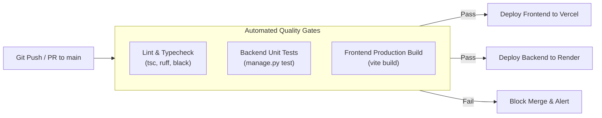

# DEPLOYMENT & DEVOPS INFRASTRUCTURE ARCHITECTURE
## Project: Technova — SmartStore AI
**Document Version:** 1.0.0
**Status:** Approved Architectural Baseline
**Date:** 2026-11-09
**Author:** DevOps & Infrastructure Engineering Team
**Repository:** `V:\Technova-recovery`

---

## 1. TARGET INFRASTRUCTURE TOPOLOGY

Technova leverages a decoupled cloud topology optimized for high reliability, global CDN distribution, and ₹0 initial operating expenses:

```mermaid
flowchart TD
    subgraph Clients ["Global End-Users"]
        Browser["Desktop & Mobile Web Browsers"]
    end

    subgraph DNS_CDN ["Edge & CDN Layer (Free Tiers)"]
        VercelEdge["Vercel Global Edge Network<br/>(Static React SPA, Automated SSL)"]
        RenderEdge["Render Global Load Balancer<br/>(TLS 1.3 Termination, Reverse Proxy)"]
    end

    subgraph Compute ["Compute Services"]
        RenderService["Render Web Service (Linux Container)<br/>- 512 MB RAM / 0.1 CPU (Free Tier)<br/>- Gunicorn WSGI + WhiteNoise<br/>- Python 3.14 + Django 5.2"]
    end

    subgraph DataServices ["Managed Data Services (Free Tiers)"]
        TiDBServerless[("TiDB Cloud Serverless<br/>- 5 GiB Storage<br/>- 50M RU / Month<br/>- Automated Daily Snapshots")]
        CloudflareR2[("Cloudflare R2 Object Storage<br/>- 10 GB Storage / Month Free<br/>- Zero Egress Fees<br/>- S3 Compatible API")]
    end

    subgraph ExternalAPIs ["Upstream SaaS Integrations"]
        RazorpayGateway["Razorpay Payments API"]
        GeminiAPI["Google Gemini Generative AI"]
    end

    Browser -->|HTTPS GET (HTML/JS/CSS)| VercelEdge
    Browser -->|HTTPS API Requests (Bearer JWT)| RenderEdge

    RenderEdge -->|Internal HTTP Proxy (X-Forwarded-Proto)| RenderService
    RenderService -->|TLS 1.2+ MySQL Connection (Port 4000)| TiDBServerless
    RenderService -->|S3 REST API (Upload/Serve Media)| CloudflareR2
    RenderService -->|HTTPS Outbound| RazorpayGateway
    RenderService -->|HTTPS Outbound| GeminiAPI
```

---

## 2. PRODUCTION CONTAINER SPECIFICATION (DOCKER)

The backend is packaged using a multi-stage, hardened Docker container based on Python 3.14 slim Debian Linux.

### Key Container Characteristics
* **Non-Root Execution:** Runs under an unprivileged system user (`appuser:appuser`, UID 1000) to mitigate container breakout vulnerabilities.
* **Minimal Base Image:** Uses `python:3.14-slim` to minimize the attack surface and reduce container image size (< 250 MB).
* **Production Static Collection:** Executes `python manage.py collectstatic --noinput` during container build, populating `backend/staticfiles` for optimized serving via WhiteNoise.
* **Process Supervisor:** Managed by `gunicorn` with worker count tuned for container memory limits:
  ```bash
  exec gunicorn config.wsgi:application \
      --bind 0.0.0.0:${PORT:-8000} \
      --workers ${WEB_CONCURRENCY:-2} \
      --threads 4 \
      --timeout 30 \
      --access-logfile - \
      --error-logfile -
  ```

---

## 3. STATIC FILES & PERSISTENT MEDIA STORAGE

### 3.1 Application Static Files (CSS, JS, Fonts)
* **Serving Layer:** WhiteNoise (`whitenoise.storage.CompressedManifestStaticFilesStorage`).
* **Caching:** Assets are fingerprinted with content hashes and served with `Cache-Control: public, max-age=31536000, immutable` headers.

### 3.2 Dynamic User Uploads (Logos, Banners, Product Images)
* **Critical Operational Risk on Render:** Render free-tier containers use an **ephemeral filesystem**. Any file written to local disk (e.g. `media/stores/logos/`) is **permanently destroyed** whenever the container spins down, restarts, or deploys.
* **Architectural Solution (Cloudflare R2 / AWS S3):**
  * Technova must transition from `django.core.files.storage.FileSystemStorage` to `django-storages[boto3]`.
  * **Provider:** Cloudflare R2 (S3-compatible API).
  * **Free-Tier Limits:** 10 GB storage free, 1,000,000 Class A operations/month, 10,000,000 Class B operations/month, and **₹0 egress fees** (unlike AWS S3).
  * **Configuration:**
    ```python
    STORAGES = {
        'default': {
            'BACKEND': 'storages.backends.s3boto3.S3Boto3Storage',
            'OPTIONS': {
                'access_key': os.getenv('R2_ACCESS_KEY_ID'),
                'secret_key': os.getenv('R2_SECRET_ACCESS_KEY'),
                'bucket_name': os.getenv('R2_BUCKET_NAME'),
                'endpoint_url': os.getenv('R2_ENDPOINT_URL'),
                'default_acl': 'public-read',
                'querystring_auth': False,
            },
        },
        'staticfiles': {
            'BACKEND': 'whitenoise.storage.CompressedManifestStaticFilesStorage',
        },
    }
    ```

---

## 4. CONTINUOUS INTEGRATION & DEPLOYMENT (CI/CD)



### Deployment Pipeline Stages
1. **Quality Gate 1 (Static Analysis):** Frontend TypeScript verification (`tsc -b`) and backend syntax verification (`git diff --check`).
2. **Quality Gate 2 (Backend Regression Testing):** Execution of the full Django automated test suite (currently 70 passing tests in SQLite memory mode).
3. **Quality Gate 3 (Frontend Compilation):** Production bundle compilation (`vite build`).
4. **Automated Deployment:**
   * **Vercel:** Monitored webhook triggers immediate edge compilation and zero-downtime deployment for the React SPA.
   * **Render:** Git deployment hook builds the Docker image, runs health checks on a temporary staging port, and shifts traffic seamlessly upon HTTP 200 confirmation.

---

## 5. HEALTH CHECKS & MONITORING

* **Health Endpoint:** `/api/health/` returning HTTP 200 OK with system status, database connectivity status, and commit SHA.
* **Uptime Monitoring:** Free external ping services (e.g. UptimeRobot, Better Uptime) configured to ping the backend health check every 10 minutes to mitigate free-tier cold-start latency.
