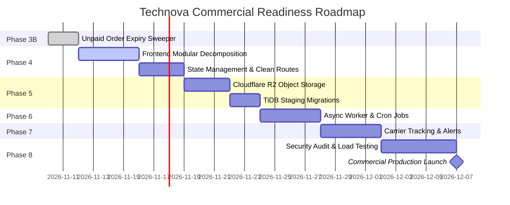

# PHASED IMPLEMENTATION ROADMAP
## Project: Technova — SmartStore AI
**Document Version:** 1.0.0
**Status:** Approved Architectural Baseline
**Date:** 2026-11-09
**Author:** Technical Product Manager & Principal Architect
**Repository:** `V:\Technova-recovery`

---

## 1. IMPLEMENTATION PHASING OVERVIEW

---

## 2. PHASE-BY-PHASE EXECUTION PLAN

### PHASE 3B — UNPAID ORDER EXPIRY & INVENTORY SWEEPER
* **Objective:** Prevent inventory starvation caused by abandoned Razorpay checkout sessions.
* **Tasks:**
  1. Create Django management command `python manage.py release_expired_orders`.
  2. Query orders where `payment_method == 'razorpay'`, `payment_status == 'pending'`, `stock_reserved == True`, and `created_at < now - 30 minutes`.
  3. Execute atomic transaction per expired order:
     * Call `release_stock(order)`.
     * Set `order.payment_status = FAILED`, `order.status = CANCELLED`, `order.stock_reserved = False`.
     * Append `OrderStatusHistory` entry noting automated expiration.
  4. Write comprehensive automated unit tests verifying that active orders are untouched, expired orders release exact quantities, and concurrent webhook captures handle expired records safely.
* **Dependencies:** Completed Phase 3A Webhook implementation.
* **Deliverable:** Management command script and unit tests.
* **Acceptance Criteria:** Uncompleted orders older than 30 minutes release stock cleanly without race conditions.

---

### PHASE 4 — FRONTEND MODULARIZATION & DECOMPOSITION
* **Objective:** Eliminate technical debt and high cognitive load in `frontend/smartstore-ai-react/src/App.tsx`.
* **Tasks:**
  1. Decompose `App.tsx` into domain-oriented feature modules:
     * `src/features/auth/AuthScreen.tsx`
     * `src/features/catalog/ProductList.tsx`, `ProductModal.tsx`
     * `src/features/catalog/CategoryManager.tsx`, `ImportModal.tsx`
     * `src/features/orders/OrderList.tsx`, `OrderDetailModal.tsx`
     * `src/features/analytics/AnalyticsView.tsx`
     * `src/features/assistant/AiAssistantPane.tsx`
     * `src/features/themes/ThemeCustomizer.tsx`
  2. Implement React router / custom view switcher with strict route guards.
  3. Extract reusable UI primitives (`MetricCard`, `Modal`, `Button`, `EmptyState`) into `src/components/ui/`.
  4. Preserve all existing authentication flows, storage event listeners, and API contracts.
* **Dependencies:** None (can proceed immediately).
* **Deliverable:** Cleaned component directory structure; `App.tsx` reduced to < 100 lines.
* **Acceptance Criteria:** `npm run build` succeeds; zero regression in UI functionality or multi-tab session synchronization.

---

### PHASE 5 — PRODUCTION STORAGE & DATABASE VALIDATION
* **Objective:** Guarantee dynamic media asset persistence across container deployments and validate TiDB Cloud schema.
* **Tasks:**
  1. Add `django-storages[boto3]` to `backend/requirements.txt`.
  2. Configure `Cloudflare R2` S3-compatible backend in `backend/config/settings.py` activated when `R2_BUCKET_NAME` is configured, falling back to `FileSystemStorage` in local development.
  3. Validate image upload endpoints (`/api/stores/:id/assets/`) with Cloudflare R2 credentials.
  4. Execute all pending migrations (`accounts`, `stores`, `token_blacklist`) against a live TiDB Cloud test cluster.
  5. Validate foreign key enforcement, UTF-8 emoji support (`utf8mb4`), and connection health checks.
* **Dependencies:** Cloudflare R2 bucket credentials and TiDB Cloud cluster access.
* **Deliverable:** Storage adapter and migration verification report.
* **Acceptance Criteria:** Uploaded store logos survive Render container restarts; TiDB runs all migrations with zero schema errors.

---

### PHASE 6 — BACKGROUND PROCESSING & CRON SCHEDULING
* **Objective:** Offload long-running operations from synchronous request threads.
* **Tasks:**
  1. Configure scheduled background execution for the Phase 3B stock sweeper:
     * Option A (₹0 Tier): Free external cron service (cron-job.org) hitting a secured endpoint `/api/internal/cron/expire-orders/` protected by a secret bearer token.
     * Option B: Render Cron Job or Redis Queue.
  2. Move bulk XLSX catalog processing into a background task if imports exceed 500 rows.
* **Dependencies:** Phase 3B completion.
* **Deliverable:** Automated cron job configuration and security token verification.
* **Acceptance Criteria:** Sweeper runs automatically every 15 minutes with zero manual intervention.

---

### PHASE 7 — DELIVERY TRACKING & CUSTOMER NOTIFICATIONS
* **Objective:** Provide end-to-end fulfillment visibility for merchants and buyers.
* **Tasks:**
  1. Add `tracking_number` and `courier_partner` fields to `Order` model.
  2. Expose courier update in merchant status change modal.
  3. Render public tracking timeline on customer order detail screen (`/orders/my/:order_number`).
  4. Prepare transactional notification adapter (Email via Resend / Brevo free tiers: 300 emails/day free).
* **Dependencies:** Phase 4 and Phase 5 completion.
* **Deliverable:** Courier tracking UI and email notification service.
* **Acceptance Criteria:** Updating an order to `SHIPPED` displays tracking details to the customer.

---

### PHASE 8 — HARDENING, PERFORMANCE BENCHMARKING & LAUNCH
* **Objective:** Comprehensive pre-flight security, performance, and reliability verification.
* **Tasks:**
  1. Run OWASP ZAP automated dynamic security scan on live staging deployment.
  2. Run load test using Locust / k6 (100 concurrent virtual users simulating browsing and checkout).
  3. Validate database connection pooling and CPU metrics on TiDB Cloud.
  4. Set up production uptime monitoring and alerting (Better Uptime / UptimeRobot).
  5. Final commercial launch sign-off.
* **Dependencies:** Phases 3B through 7 complete.
* **Deliverable:** Pre-Launch Audit Report and Production Cutover Sign-off.
* **Acceptance Criteria:** p95 latency < 300ms, zero security vulnerabilities, 100% automated test pass rate.
