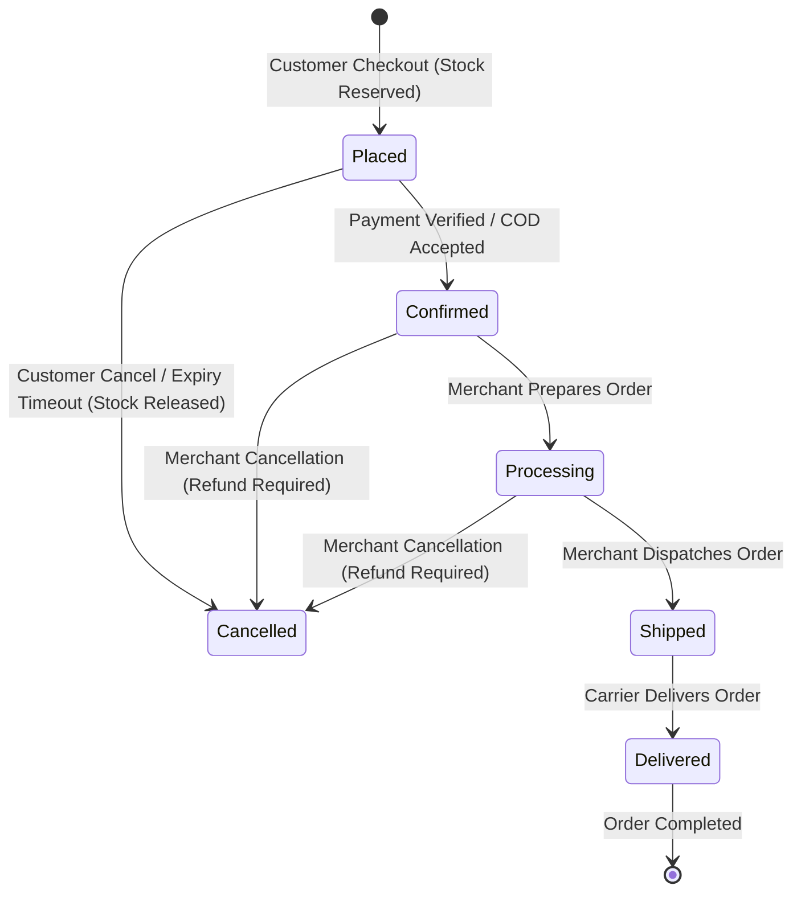

# SOFTWARE REQUIREMENTS SPECIFICATION (SRS)
## Project: Technova — SmartStore AI
**Document Version:** 1.0.0
**Status:** Approved for Architectural Baseline
**Date:** 2026-11-09
**Author:** Principal Software Architecture & Engineering Team
**Repository:** `V:\Technova-recovery`

---

## 1. PROJECT OVERVIEW & VISION

### 1.1 Executive Summary
**Technova (SmartStore AI)** is a cloud-native, multi-tenant e-commerce Software-as-a-Service (SaaS) platform designed to empower non-technical merchants and small-to-medium businesses (SMBs) to create, operate, and scale branded online storefronts effortlessly. Technova delivers a centralized backend and frontend application infrastructure that unifies product catalog management, inventory tracking, order processing, secure digital and cash-on-delivery payments, AI-driven business intelligence, and customer storefront browsing.

### 1.2 Core Vision & Identity
* **Authentication-First Platform:** Technova is an authenticated enterprise workspace. There is **no guest browsing of the workspace**, **no preview mode**, **no demo mode**, and **no authentication bypass**. Every user must be securely authenticated before accessing merchant administrative tools or private store data.
* **Multi-Tenant Isolation:** Technova hosts multiple independent businesses on shared infrastructure. Strict tenant boundaries are enforced across all layers—database queries, business logic, file storage, and API responses. One merchant can never access, query, modify, or infer another merchant's data.
* **AI-Augmented Operations:** Integrated Google Gemini generative AI serves as an on-demand business co-pilot, answering natural language inventory, revenue, and product inquiries strictly grounded in verified database facts.
* **Zero Initial Infrastructure Cost:** Designed to achieve commercial viability with a ₹0 initial operating cost by leveraging high-utility free and open tiers (Render, Vercel, TiDB Cloud, Cloudflare R2) without compromising security or reliability.

---

## 2. SCOPE & BOUNDARIES

### 2.1 In-Scope (Commercial MVP / Initial Release)
1. **Authentication & Identity:** User registration, password validation, JWT authentication with refresh token blacklisting, secure logout, and session lifecycle management.
2. **Multi-Tenant Store Management:** Tenant creation, slug reservation, store profile customization, logo/banner branding uploads, and publishing state control.
3. **Role-Based Tenant Access (RBAC):** Store-level memberships (`Owner`, `Admin`, `Editor`, `Viewer`) restricting tenant administrative mutations.
4. **Catalog & Category Management:** Category creation, bulk category ingestion, product catalog creation, updates, soft/protected deletion, and Excel (XLSX) template-based bulk import.
5. **Inventory Management:** Stock tracking, low-stock threshold alerting, atomic stock reservations during checkout, and automated stock restoration.
6. **Customer Storefront Experience:** Authenticated storefront discovery, category filtering, search, cart management, and checkout.
7. **Order & Checkout Processing:** Server-calculated checkout totals, idempotency key verification, multi-stage order lifecycle tracking, customer order history, and cancellation.
8. **Payment Integrations:** Asynchronous Razorpay webhook processing with HMAC SHA-256 signature verification, payment retry safety, and Cash on Delivery (COD) collection workflows.
9. **AI Business Assistant:** Scoped natural language assistant utilizing Google Gemini to analyze real-time inventory and sales trends.
10. **Analytics & Reporting:** Store-scoped revenue, order volume, and inventory health metrics.

### 2.2 Out-of-Scope (Future Enhancements)
* Custom domain mapping (e.g., `store.merchant.com`) and automated SSL certificate provisioning.
* Standalone frontend deployments per merchant (storefronts initially execute under `/store/:slug` within the centralized React application).
* Native mobile applications (iOS/Android).
* Multi-warehouse logistics and automated third-party courier dispatch integrations (e.g., Shiprocket, Delhivery).
* Multi-currency international forex checkout (initial version standardizes on INR).

---

## 3. STAKEHOLDERS & USER PERSONAS

| Role ID | Role Name | Description | Access Scope |
|---|---|---|---|
| **USR-ADM** | **Platform Administrator** | Technova platform operators responsible for tenant health, system monitoring, and global configuration. | Global platform access, cross-tenant system telemetry (read-only audit), user moderation. |
| **USR-OWN** | **Store Owner** | Merchant business principal who registers the store, manages banking/payments, hires staff, and configures themes. | Full control over owned tenant(s), billing settings, staff memberships, catalog, and orders. |
| **USR-MGR** | **Store Admin / Editor** | Operational staff employed by the merchant to manage daily products, inventory, and order fulfillment. | Tenant-scoped read/write on catalog, stock, and orders. Cannot delete the store or manage owners. |
| **USR-CUS** | **Customer / Buyer** | End-consumer who browses published storefronts, adds items to carts, checks out, and tracks purchases. | Authenticated customer access to published stores, personal cart, and personal order history. |
| **SYS-AUT** | **Automated Worker** | System background jobs and webhook processors executing scheduled maintenance and external events. | Razorpay webhook consumer, unpaid order stock expiration sweeper, audit logger. |

---

## 4. BUSINESS RULES & POLICIES (BR)

* **BR-01 (Mandatory Authentication):** Unauthenticated users cannot access any private API or merchant workspace view. Opening the application displays the login/signup gateway.
* **BR-02 (Store Slug Immutability & Uniqueness):** Store slugs are globally unique alphanumeric identifiers generated server-side. Once published, store slugs cannot be altered without platform intervention to preserve link integrity.
* **BR-03 (Tenant Isolation Guarantee):** Every database read, update, or delete operation on tenant assets (`Category`, `Product`, `Order`, `OrderItem`, `Analytics`) must explicitly filter by `store_id` derived from verified membership credentials.
* **BR-04 (Server-Authoritative Pricing):** Client-submitted prices, discounts, or subtotals are strictly ignored during checkout. Totals are computed exclusively from database records in an atomic transaction.
* **BR-05 (Inventory Reservation at Checkout):** Product inventory is atomically deducted upon order creation (`stock_reserved = True`). If payment fails, stock remains reserved during customer retry windows until cancelled or expired.
* **BR-06 (Order Protection Integrity):** Products referenced in historical order items (`OrderItem`) cannot be hard-deleted from the database; deletions must be rejected with HTTP 409 Conflict.
* **BR-07 (Payment Webhook Authority):** Webhook events from Razorpay are verified using constant-time HMAC SHA-256 comparison against raw request bytes. No client-reported payment status is trusted without cryptographic verification.
* **BR-08 (COD Settlement Protection):** Cash on Delivery (COD) orders can only have payment collected after the order status reaches `DELIVERED`.

---

## 5. FUNCTIONAL REQUIREMENTS (FR)

### 5.1 Authentication and Identity Management (AUTH)
* **REQ-AUTH-001:** The system shall require user authentication prior to rendering the main application workspace.
* **REQ-AUTH-002:** The system shall support new user registration via unique email, username, and password.
* **REQ-AUTH-003:** The system shall enforce Django's standard password validation suite (minimum 8 characters, common password rejection, user attribute similarity checks, and numeric checks).
* **REQ-AUTH-004:** The system shall authenticate users via JWT (JSON Web Tokens) with a 5-minute access token lifespan and 24-hour refresh token lifespan.
* **REQ-AUTH-005:** The system shall implement refresh token rotation and server-side blacklisting upon token refresh.
* **REQ-AUTH-006:** The system shall provide a `/api/auth/logout/` endpoint that immediately blacklists the active refresh token.
* **REQ-AUTH-007:** The system shall rate-limit login attempts to 10 requests per minute and registration to 5 requests per minute per IP.
* **REQ-AUTH-008:** The system shall return current user profile metadata via `/api/auth/me/`.

### 5.2 Store & Tenant Management (STORE)
* **REQ-STORE-001:** An authenticated user shall be able to create one or more independent stores.
* **REQ-STORE-002:** Store creation shall automatically assign the creator the `Owner` membership role within an atomic transaction.
* **REQ-STORE-003:** The system shall validate store slug uniqueness and provide a real-time availability check endpoint (`/api/stores/slug-availability/`).
* **REQ-STORE-004:** The system shall allow authorized store members (`Owner`, `Admin`, `Editor`) to upload branding logos and banners via `/api/stores/:id/assets/`.
* **REQ-STORE-005:** The system shall restrict store publishing (`/api/stores/:slug/publish/`) to published states only when mandatory business profile information exists.
* **REQ-STORE-006:** The system shall allow selection and configuration of pre-built store visual themes (`modern-clean`, `premium-dark`, `fresh-grocery`, `elegant-boutique`).

### 5.3 Product & Category Management (CATALOG)
* **REQ-CAT-001:** Store operators shall be able to create, view, update, and delete categories scoped exclusively to their tenant.
* **REQ-CAT-002:** The system shall support bulk category creation with deduplication within an atomic transaction.
* **REQ-CAT-003:** Store operators shall create products with name, description, SKU, price, stock, low-stock threshold, image URL, and category association.
* **REQ-CAT-004:** Product SKU must be unique within a tenant store.
* **REQ-CAT-005:** The system shall reject product deletion with HTTP 409 Conflict if the product is linked to existing `OrderItem` records.
* **REQ-CAT-006:** The system shall provide an XLSX product import template (`/api/stores/:slug/products/import/template/`) pre-populated with tenant categories.
* **REQ-CAT-007:** The system shall process bulk XLSX product uploads with dry-run validation, row-by-row error reporting, and transactional commit.

### 5.4 Inventory & Stock Control (INV)
* **REQ-INV-001:** The system shall track available on-hand stock per product.
* **REQ-INV-002:** The system shall atomically decrement stock upon checkout order placement.
* **REQ-INV-003:** The system shall reject checkout if any item quantity exceeds currently available stock.
* **REQ-INV-004:** The system shall provide low-stock alerting when product stock falls below `low_stock_threshold`.
* **REQ-INV-005:** The system shall release reserved stock upon explicit order cancellation or automated expiration of abandoned payment sessions.

### 5.5 Shopping Cart & Checkout (CHECKOUT)
* **REQ-CART-001:** Storefront customers shall maintain a tenant-scoped shopping cart persisted locally and verified server-side.
* **REQ-CART-002:** Checkout shall require user authentication and customer profile details (name, phone, delivery address).
* **REQ-CART-003:** Checkout shall accept a mandatory client-generated `Idempotency-Key` header.
* **REQ-CART-004:** The system shall calculate subtotal, delivery charges, and final order total on the backend using database prices.
* **REQ-CART-005:** Repeat checkout requests with the same idempotency key and request payload shall return the existing order without duplicate stock deductions.

### 5.6 Order Processing & Lifecycle (ORDER)
* **REQ-ORD-001:** Each placed order shall receive a unique 24-character human-readable tracking number (e.g., `SS-06F60AAB4D824F2BBFCA`).
* **REQ-ORD-002:** Orders shall transition through strict state machine phases: `Placed` -> `Confirmed` -> `Processing` -> `Shipped` -> `Delivered` (or `Cancelled`).
* **REQ-ORD-003:** Every order status transition shall be recorded in `OrderStatusHistory` with timestamp, user ID, and audit note.
* **REQ-ORD-004:** Customers shall be able to view their personal order history via `/api/orders/my/`.
* **REQ-ORD-005:** Customers shall be permitted to cancel an unpaid order, triggering atomic stock restoration.
* **REQ-ORD-006:** Store operators shall view and update orders belonging exclusively to their store via `/api/stores/:slug/orders/`.

### 5.7 Payments & Financial Reconciliation (PAY)
* **REQ-PAY-001:** The system shall support Cash on Delivery (COD) and Razorpay digital payments.
* **REQ-PAY-002:** Digital payment initialization (`/api/orders/:number/payment/create/`) shall create a Razorpay provider order using server credentials and server totals.
* **REQ-PAY-003:** Payment verification (`/api/orders/:number/payment/verify/`) shall validate HMAC SHA-256 signatures and query Razorpay server-to-server.
* **REQ-PAY-004:** Asynchronous Razorpay webhooks (`/api/payments/razorpay/webhook/`) shall process `payment.captured`, `order.paid`, and `payment.failed` events idempotently.
* **REQ-PAY-005:** Webhook processing shall verify that provider order IDs match local order records, and that payload amount and currency strictly match database totals.
* **REQ-PAY-006:** Failed payment attempts (`payment.failed`) shall record the failure in order history while preserving reserved inventory for customer retry.

### 5.8 AI Business Assistant (AI)
* **REQ-AI-001:** Store operators shall query store inventory, catalog health, and sales reports in natural language via `/api/ai/chat/`.
* **REQ-AI-002:** The AI service shall extract verified database facts (catalog summary, low stock products, period order counts, order values) before invoking Gemini.
* **REQ-AI-003:** System instructions shall enforce that the AI answers strictly using supplied JSON facts, refusing prompt injections and speculation.
* **REQ-AI-004:** The AI endpoint shall enforce strict rate limiting (10 requests per minute) and a 15-second response timeout.

### 5.9 Analytics & Reporting (ANA)
* **REQ-ANA-001:** The system shall calculate real-time tenant metrics including total revenue, order count, pending orders, and low-stock count.
* **REQ-ANA-002:** Historical sales calculations shall exclude cancelled orders and respect time boundaries (today, this week, last week, this month).

---

## 6. NON-FUNCTIONAL REQUIREMENTS (NFR)

| ID | Category | Requirement & Acceptance Criteria |
|---|---|---|
| **NFR-SEC-001** | Security | All network communications must be encrypted using TLS 1.3 (minimum TLS 1.2). HSTS must be enforced with 1-year max-age. |
| **NFR-SEC-002** | Security | Zero secrets or private keys in frontend bundles. All credentials must be loaded via server environment variables. |
| **NFR-SEC-003** | Security | Strict CORS origin allowlist configured. Direct wildcard origins (`*`) are prohibited in production. |
| **NFR-SEC-004** | Security | Passwords hashed using Argon2 or PBKDF2 with SHA-256 and minimum 600,000 iterations. |
| **NFR-PERF-001**| Performance | 95th percentile (p95) API response time < 250ms for catalog reads and < 500ms for checkout under 100 concurrent requests. |
| **NFR-PERF-002**| Performance | Frontend initial page load (FCP) < 1.5 seconds; Largest Contentful Paint (LCP) < 2.5 seconds on a 4G mobile network. |
| **NFR-AVAIL-001**| Availability | Core API and Storefront availability target of 99.9% uptime during business hours. |
| **NFR-SCAL-001**| Scalability | Horizontal stateless scaling of backend container instances behind load balancers with zero session affinity dependency. |
| **NFR-REL-001** | Reliability | Transactional atomicity: No order can be persisted without corresponding stock deduction; zero phantom stock deductions. |
| **NFR-REL-002** | Reliability | Webhook idempotency: Exactly-once side effects for repeated or out-of-order payment provider webhooks. |
| **NFR-MAINT-001**| Maintainability | Automated test suite coverage > 85% for business-critical payment, inventory, and authentication modules. |
| **NFR-DATA-001** | Data Integrity| Strict foreign key relationships with `PROTECT` on historical order references and cascade constraints on tenant assets. |
| **NFR-AUDIT-001**| Auditability | Structured JSON logging capturing all authentication events, role changes, payment transitions, and administrative deletions without logging sensitive credentials. |

---

## 7. USER WORKFLOWS & STATE MACHINES

---

## 8. ASSUMPTIONS & CONSTRAINTS

1. **Free-Tier Constraints:** The system must operate within the limits of Render's free web service (spins down after 15 min inactivity), TiDB Cloud Starter (5 GiB free storage), and Vercel Hobby tier.
2. **Synchronous Worker Limitation:** Background tasks (such as payment expiration sweepers) must be capable of running as scheduled cron jobs or management commands until an asynchronous message broker (Redis/Celery) is introduced.
3. **Currency & Localization:** All prices are handled in Indian Rupees (`INR`) formatted to 2 decimal places. Timezone default is UTC internally and Asia/Kolkata (`IST`) for localized reports.
4. **Browser Compatibility:** Frontend supports modern evergreen browsers (Chrome, Firefox, Safari, Edge) from the last 2 major versions.
