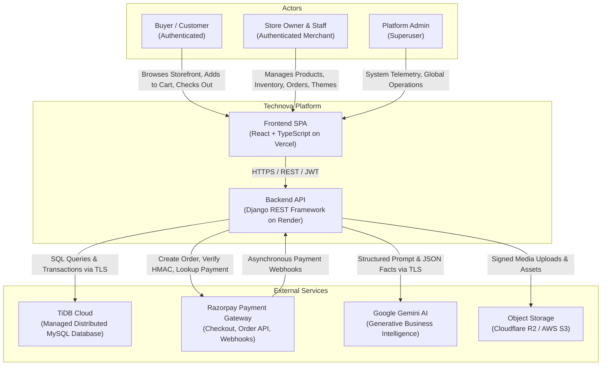
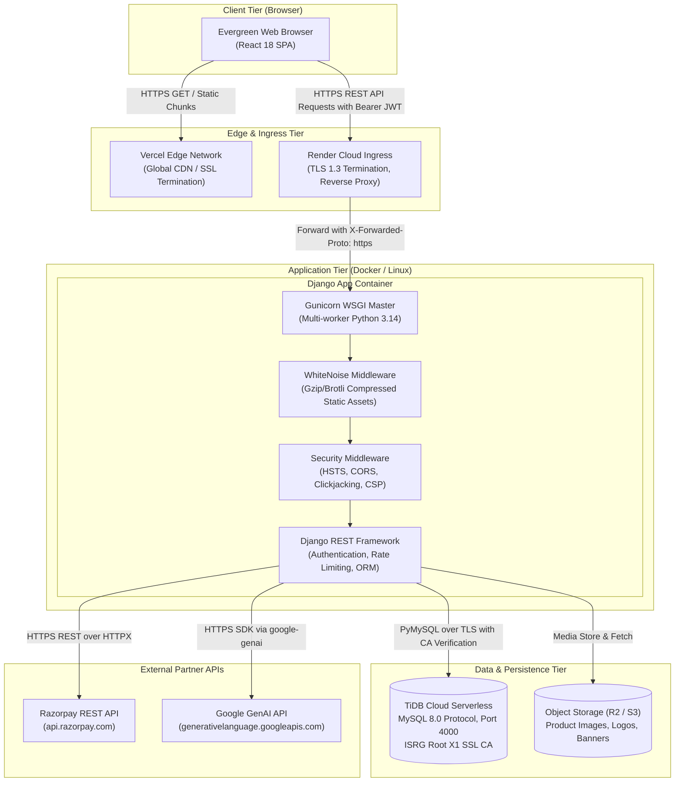
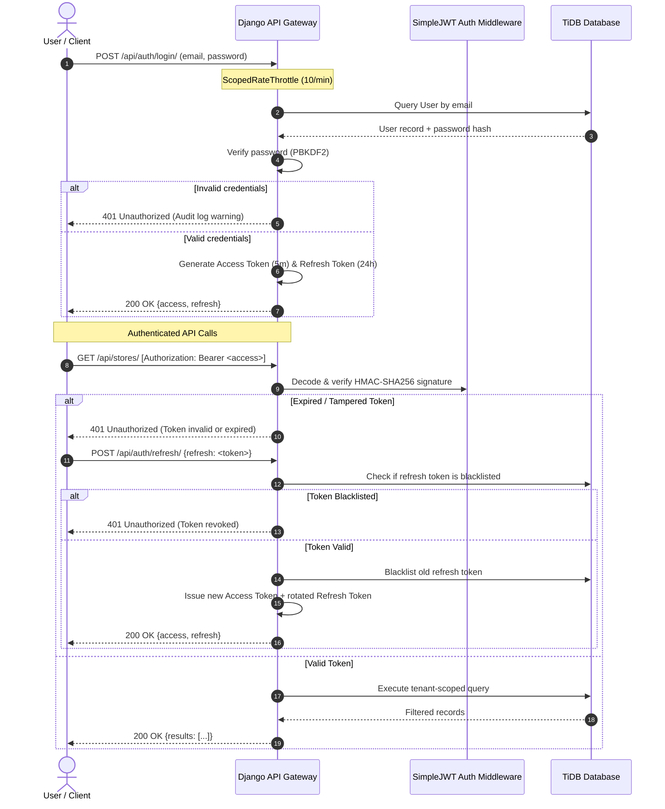
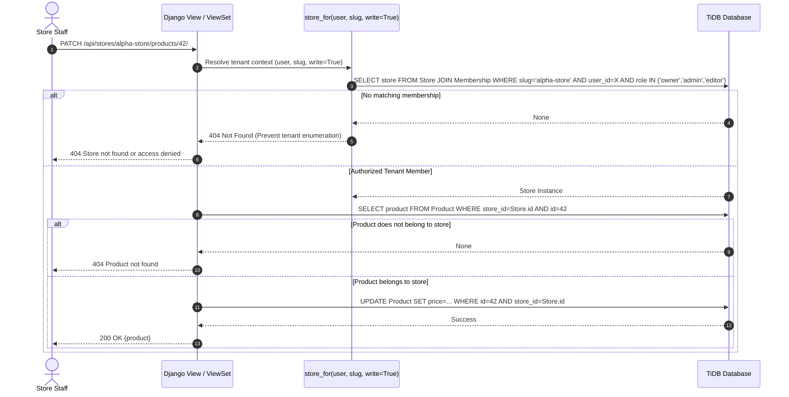
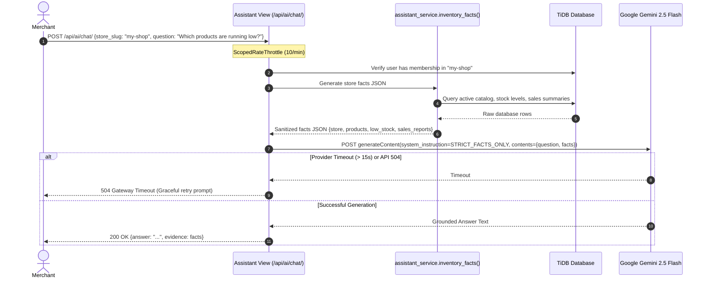

# SYSTEM ARCHITECTURE DESIGN
## Project: Technova — SmartStore AI
**Document Version:** 1.0.0
**Status:** Architectural Baseline
**Date:** 2026-11-09
**Author:** Principal Software Architecture & Engineering Team
**Repository:** `V:\Technova-recovery`

---

## 1. ARCHITECTURAL PHILOSOPHY & PRINCIPLES

Technova is architected around the **Modular Monolithic** design pattern. For an early-stage to high-growth multi-tenant SaaS platform, a well-structured modular monolith provides the optimal balance of development velocity, transactional data integrity, low operational complexity, and ₹0-friendly deployment economics, while cleanly establishing architectural boundaries that can be split into microservices if specific domains demand independent scale in the future.

### Key Engineering Principles
1. **SOLID Principles:** Single responsibility per Django app/module; open for extension via pluggable theme configurations and payment adapters; interface segregation through targeted REST serializers; dependency inversion by decoupling payment gateway specifics behind provider abstractions.
2. **DRY & KISS:** Common business logic (such as tenant slug resolution, currency formatting, and inventory reservation) is consolidated into domain services rather than duplicated across views. Code remains explicit and straightforward.
3. **High Cohesion & Low Coupling:** Domain boundaries (`accounts`, `stores`, `orders`, `catalog`, `payments`, `assistant`) encapsulate their own data access and validation rules, interacting through clear Python service interfaces.
4. **Security by Design & Fail-Safe Defaults:** Every endpoint requires authentication by default (`IsAuthenticated`), with public access granted only to explicitly allowlisted routes (`AllowAny`). Tenant authorization checks run on every database lookup.
5. **Stateless Backend Execution:** The Django application holds zero in-memory session state across requests. Session identity is established via cryptographic JWTs, allowing seamless horizontal scaling behind load balancers.

---

## 2. SYSTEM CONTEXT DIAGRAM (C4 LEVEL 1)

The following diagram illustrates how Technova interacts with human actors and external cloud services:



---

## 3. CONTAINER ARCHITECTURE DIAGRAM (C4 LEVEL 2)

The container view details the execution environments, deployment topology, and protocols connecting system subsystems:



---

## 4. BACKEND MODULE ARCHITECTURE (MODULAR MONOLITH)

The Django backend is decomposed into domain-specific modules adhering to separation of concerns:

```text
backend/
├── config/                  # Core orchestration & project settings
│   ├── settings.py          # Security, Database, JWT, Logging, CORS config
│   ├── api_urls.py          # Canonical REST API routing table
│   ├── wsgi.py / asgi.py    # Production web server entrypoints
├── apps/
│   ├── accounts/            # Identity & Access Management
│   │   ├── models.py        # Custom Email-based User model
│   │   ├── auth.py          # JWT authentication, refresh blacklisting
│   │   ├── serializers.py   # User registration & profile serializers
│   │   └── throttles.py     # IP & user-scoped rate limiters
│   ├── stores/              # Multi-Tenant Business & Storefront Domain
│   │   ├── models.py        # Store, Membership, Category, Product, Order
│   │   ├── views.py         # Store CRUD, Catalog, Categories, Analytics
│   │   ├── order_views.py   # Checkout, Customer Orders, Razorpay Webhook
│   │   ├── assistant_views.py # AI Chat endpoints
│   │   ├── assistant_service.py # Gemini RAG facts extraction & grounding
│   │   ├── imports.py       # Excel (XLSX) streaming parser & validation
│   │   ├── serializers.py   # Catalog serializers with tenant scoping
│   │   └── order_serializers.py # Order & Item read/write serializers
```

---

## 5. DETAILED DATA FLOW ARCHITECTURES

### 5.1 Authentication & Token Verification Flow


### 5.2 Multi-Tenant Data Isolation Flow


### 5.3 Checkout & Asynchronous Razorpay Webhook Flow
```mermaid
sequenceDiagram
    autonumber
    actor Customer as Customer (Frontend)
    participant API as Technova Backend API
    participant DB as TiDB Database
    participant Razorpay as Razorpay API / Webhook

    Customer->>API: POST /api/public/stores/:slug/checkout/ [Idempotency-Key]
    critical Atomic Checkout Transaction
        API->>DB: Lock requested products (SELECT FOR UPDATE)
        API->>API: Validate stock availability & compute true DB totals
        API->>DB: Decrement stock, create Order (status=Placed, payment_status=Pending, stock_reserved=True)
    end
    API-->>Customer: 201 Created {order_number, total}

    Customer->>API: POST /api/orders/:number/payment/create/
    API->>Razorpay: POST /v1/orders {amount, currency, receipt=order_number}
    Razorpay-->>API: 201 Created {id: "order_rzp_123"}
    API->>DB: Update Order.razorpay_order_id = "order_rzp_123"
    API-->>Customer: 201 Created {key_id, razorpay_order_id, amount}

    Customer->>Customer: Complete payment via Razorpay Modal
    Razorpay->>API: POST /api/payments/razorpay/webhook/ [X-Razorpay-Signature]
    API->>API: Constant-time HMAC-SHA256 signature verification
    alt Invalid Signature
        API-->>Razorpay: 400 Bad Request (Reject untrusted payload)
    else Signature Verified
        critical Atomic Webhook Processing
            API->>DB: Lock Order (SELECT FOR UPDATE by razorpay_order_id)
            API->>API: Cross-check order_id, amount, currency against DB
            alt event == 'payment.captured' or 'order.paid'
                API->>DB: Set payment_status=PAID, status=CONFIRMED, record razorpay_payment_id
                API->>DB: Add OrderStatusHistory audit entry
            else event == 'payment.failed'
                API->>DB: Record attempt failure; KEEP stock_reserved=True for retry
            end
        end
        API-->>Razorpay: 200 OK {detail: "Payment recorded successfully"}
    end
```

### 5.4 Gemini AI RAG & Grounded Facts Flow


---

## 6. FRONTEND SPA ARCHITECTURE

The frontend is a single-page application built with React 18, TypeScript, and Vite.

### Core Architectural Layers
1. **API Client Layer (`src/api.ts`):** Centralized HTTP abstraction over `fetch`. Handles automatic JWT injection, synchronized token refresh across tabs, 401 retry loops, and error transformation.
2. **State & Synchronization Layer:** Multi-tab storage sync (`storage` event listeners) guaranteeing that session invalidation in one tab instantly updates all active tabs.
3. **Route & View Controller Layer (`src/App.tsx`, `src/PublicStorefront.tsx`):**
   * **Authentication Guard:** Renders `<AuthScreen/>` whenever tokens are missing or invalidated.
   * **Storefront Controller (`/store/:slug`):** Public customer shopping view with local cart persistence.
   * **Workspace Controller (`/`):** Merchant operational dashboard managing catalog, orders, analytics, themes, and AI assistant.
